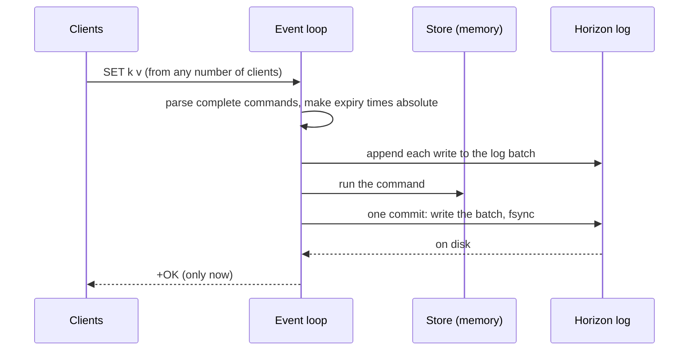

<div align="center">

# ⚡ Tachyon

**A Redis-compatible key-value server in C++20, with its own crash-safe storage engine.**

[](https://github.com/healers2004/Tachyon/actions/workflows/ci.yml)


[](LICENSE)

**31** Redis commands · **0** mismatches against real Redis · **131** unit tests · **102** crash runs, nothing lost

[Quick start](#-quick-start) · [Architecture](#-architecture) · [Durability](#-durability) · [Benchmarks](#-benchmarks) · [Testing](#-testing)

</div>

---

Tachyon speaks **RESP2**, the Redis wire protocol, so the real `redis-cli`, `redis-benchmark`
and any Redis client library work against it unchanged. Underneath is **Horizon**, a storage
engine built for it: a checksummed write-ahead log with group commit, plus snapshots that are
safe to interrupt at any step. It runs on Linux and Windows with no dependencies beyond the C++
standard library.

```console
$ redis-cli -p 6380 SET session:42 "logged in" EX 1800
OK
$ redis-cli -p 6380 RPUSH jobs resize-image send-email
(integer) 2
$ redis-cli -p 6380 HSET user:42 name Vaasu city Ottawa
(integer) 2
$ redis-cli -p 6380 TTL session:42
(integer) 1800
$ redis-cli -p 6380 LPUSH session:42 oops
(error) WRONGTYPE Operation against a key holding the wrong kind of value
```

> *The names:* a tachyon is a hypothetical particle faster than light. Nothing that crosses a
> black hole's event horizon ever escapes, so a write that reaches Horizon is never lost.

## ✨ Highlights

|  |  |
| --- | --- |
| 🔌 **Drop-in compatible** | Every supported command replies exactly as Redis 7 does, byte for byte, error messages included. A script checks this against a real Redis on every push. |
| 🛡️ **Crash-safe** | Nothing is acknowledged before it's on disk. A crash test kills the server mid-write and mid-snapshot 102 times in a row and checks every acknowledged write. |
| ⚙️ **One thread, many clients** | A non-blocking `poll()` event loop, the same model as Redis, with a read and write buffer per client and backpressure for clients that stop reading. |
| 🧪 **Tested hard** | Unit tests, end-to-end tests with the real Redis tools, fuzzing with libFuzzer, a full-disk test, and AddressSanitizer + UndefinedBehaviorSanitizer in CI. |

## 🚀 Quick start

```bash
cmake -S . -B build -DCMAKE_BUILD_TYPE=Release
cmake --build build --config Release
./build/tachyon/tachyon             # Windows: build\tachyon\Release\tachyon.exe
```

Then, in another terminal, use any Redis client:

```bash
redis-cli -p 6380 PING
redis-cli -p 6380 INFO keyspace
```

Tachyon listens on **127.0.0.1:6380**, so it never clashes with a real Redis on 6379, and
nothing else on the network can reach it. Ctrl+C shuts it down cleanly, even with clients
connected.

<details>
<summary><b>All options</b></summary>

| Option | Default | Meaning |
| --- | --- | --- |
| `--port N` | `6380` | TCP port to listen on (always on 127.0.0.1) |
| `--dir PATH` | `.` | Existing directory for `tachyon.snapshot` and `tachyon.log.<N>` |
| `--fsync always\|everysec` | `always` | When the log is flushed to disk (see [Durability](#-durability)) |
| `--snapshot-after BYTES` | `67108864` | Take a snapshot once the log reaches this size (or the last snapshot's, if bigger); `0` = only on `SAVE` |
| `--no-persist` | off | Keep data in memory only; write nothing to disk |
| `--loglevel LEVEL` | `notice` | `debug`, `verbose`, `notice` or `warning`, as in Redis |
| `--version` | | Print the version and exit |

</details>

## 📚 Supported commands

| Group | Commands |
| --- | --- |
| Connection | `PING` `ECHO` `QUIT` |
| Strings | `GET` `SET` (with `NX` `XX` `EX` `PX` `EXAT` `PXAT` `KEEPTTL`) `DEL` `EXISTS` |
| Hashes | `HSET` `HGET` `HGETALL` `HDEL` `HLEN` |
| Lists | `LPUSH` `RPUSH` `LPOP` `RPOP` (with count) `LRANGE` `LTRIM` `LLEN` |
| Expiry | `EXPIRE` `PEXPIREAT` `TTL` `PERSIST` |
| Keyspace | `TYPE` `DBSIZE` `FLUSHALL` |
| Pub/sub | `SUBSCRIBE` `UNSUBSCRIBE` `PUBLISH` |
| Server | `SAVE` `INFO` |

<details>
<summary><b>Behaviour details and what's not supported yet</b></summary>

Behaviour follows Redis: using a key as the wrong type gives the `WRONGTYPE` error; emptied
hashes and lists are deleted; expired keys are removed when accessed and by a sweep about once
a second; a subscribed connection only accepts `SUBSCRIBE`, `UNSUBSCRIBE`, `PING` and `QUIT`;
pub/sub messages aren't stored, so a channel with no subscribers drops them; a subscriber that
falls 32 MB behind is disconnected. Only RESP arrays are accepted as commands, so an HTTP
request sent to the port is rejected on its first byte.

**Not supported yet:** other data types (sets, sorted sets, streams), `INCR` and friends,
pattern subscriptions (`PSUBSCRIBE`), `PUBSUB`, `RESET`, `CONFIG`, `SET ... GET`, `EXPIRE`'s
`NX`/`XX`/`GT`/`LT`, inline (plain-text) commands, RESP3, authentication and replication.
`HGETALL` returns fields in hash-table order; Redis keeps insertion order for small hashes.

</details>

## 🏗️ Architecture

```
  redis-cli, redis-benchmark, any Redis client library
                     │  RESP2 over TCP (default 127.0.0.1:6380)
                     ▼
 ┌──────────────────────────── tachyon ─────────────────────────────┐
 │  server/     event loop, connections, pub/sub, SAVE and INFO      │
 │  protocol/   RESP parser and reply writer                         │
 │  commands/   command table, strings, hashes, lists, expiry        │
 │  platform/   sockets: posix/ and win32/ behind one header         │
 └──────────────────────────────┬────────────────────────────────────┘
                                │ horizon/engine.h and horizon/log.h only
                                ▼
 ┌──────────────────────────── horizon ─────────────────────────────┐
 │  engine      snapshot + log generations, recovery, compaction     │
 │  log         append-only records: [length][CRC32][payload]        │
 │  platform/   files: fsync, atomic rename (posix/ and win32/)      │
 └──────────────────────────────┬────────────────────────────────────┘
                                ▼
                 tachyon.snapshot, tachyon.log.<N>  (in --dir)
```

- **Horizon** knows nothing about networking or Redis. It stores and replays opaque records,
  so any program can use it as a storage engine.
- **Tachyon** uses Horizon only through one class, `CommandLog`, and runs without it
  (`--no-persist`).
- **OS-specific code** lives only in each component's `platform/` folder; CMake picks the POSIX
  or Win32 file for the machine it's building on.

**The life of a write.** Every reply waits for the disk, but one flush covers every client that
wrote in the same pass of the event loop (group commit):



## 🛡️ Durability

| Mode | An acknowledged write survives… |
| --- | --- |
| `--fsync always` (default) | a crash **and** a power cut: the log is flushed (`fsync` / `FlushFileBuffers`) before the reply |
| `--fsync everysec` | a crash; a power cut can lose about the last second |
| `--no-persist` | nothing: memory only, like a pure cache |

<details>
<summary><b>How it works: the log, snapshots, crashes and full disks</b></summary>

**The log.** Every write command is appended to a write-ahead log **before** its reply is
sent. Each record is a 4-byte length, a CRC32 checksum and the command itself, in the same RESP
form a client sends. Relative expiry times are logged as absolute ones (`EXPIRE k 10` becomes
`PEXPIREAT k <time>`, as Redis does), so a deadline doesn't restart when the log is replayed.
A crash in the middle of writing a record leaves an incomplete or damaged *last* record;
recovery drops it (it was never acknowledged) and logging continues after it. Damage anywhere
else stops startup with an error, rather than silently losing the records after it.

**Snapshots** keep the log short. On `SAVE`, or once the log passes `--snapshot-after` bytes
(or the size of the last snapshot, if that's bigger, so a large dataset isn't rewritten after
every few writes), Tachyon writes the dataset to a temp file in chunks, flushes it, and renames
it over the old snapshot (`MoveFileEx` with `MOVEFILE_WRITE_THROUGH` on Windows; plus a
directory `fsync` on Linux). The rename is atomic, so the snapshot file is always either the
complete old one or the complete new one. Each log file has a generation number, and the
snapshot names the generation that continues after it, so a crash at any step either keeps the
old snapshot and old log or uses the new ones: no change is ever lost or applied twice. Startup
loads the snapshot, then replays only the log after it. Snapshots run synchronously (Windows has
no `fork()`), which pauses the server for the length of the snapshot.

**When the disk is full,** a snapshot that can't be written fails cleanly: the temp file is
removed, the old snapshot and log stay in charge, the server keeps serving, and `INFO` shows
`rdb_last_bgsave_status:err`. A log write that fails stops the server without acknowledging
that round of writes, since memory would otherwise be ahead of the disk; every write
acknowledged before is safe. Free some space and restart.

**Upgrading from a pre-1.0 build:** those wrote one log file, `tachyon.wal`. If a data directory
has it and no newer files, Tachyon renames it to `tachyon.log.1` (same format) and loads it.

**What the tests prove:** `tools/crash_test.sh` kills the process (`kill -9` at random moments,
and an abort at each step of a snapshot), restarts it and checks every acknowledged write. That
proves crash safety. It doesn't prove power-cut safety: after a killed process, the operating
system still writes its cache to disk. Power-cut safety rests on the fsync order above.

</details>

## 📊 Benchmarks

Redis 7.0.15, Valkey 7.2.13 and Tachyon 1.0.0 (Release), run one at a time on the same machine
with the same `redis-benchmark` settings: 50 clients, requests per second, higher is better.

| Workload | Test | Redis 7.0 | Valkey 7.2 | Tachyon | vs Redis |
| --- | --- | ---: | ---: | ---: | ---: |
| In memory | `GET` | 47,551 | 49,079 | **61,785** | 1.30× |
| In memory | `SET` | 50,100 | 49,714 | **60,459** | 1.21× |
| In memory | `HSET` | 47,281 | 50,163 | **61,842** | 1.31× |
| In memory | `LPUSH` | 48,239 | 48,875 | **60,150** | 1.25× |
| Durable (fsync every write) | `SET` | 4,852 | 4,872 | 4,748 | 0.98× |
| Durable (fsync every write) | `LPUSH` | 4,852 | 4,856 | 4,859 | 1.00× |
| Pipelined (16 per round trip) | `SET` | 819,672 | 784,313 | **896,860** | 1.09× |
| Pipelined (16 per round trip) | `GET` | 847,457 | 862,069 | **934,579** | 1.10× |

> **Read this honestly:** Tachyon is not a faster Redis. Redis does far more per command
> (per-command stats, LRU clocks, ACL and keyspace-notification checks, several encodings per
> type) and supports hundreds of commands; Tachyon does only what its 31 need. Redis's `epoll`
> loop also scales to thousands of clients, where Tachyon's `poll()` loop doesn't. With an
> fsync on every write, all three are limited by the disk.

<details>
<summary><b>Full results, setup and profiling notes</b></summary>

Machine: 16 vCPUs under WSL2 (Linux 5.15) on Windows 11, everything over loopback. 200,000
requests per test (50,000 for the durable tests). Repeated runs vary by about 5%.
In memory: Redis/Valkey `--save '' --appendonly no`, Tachyon `--no-persist`. Durable:
Redis/Valkey `--appendonly yes --appendfsync always`, Tachyon `--fsync always`.

| Test (in memory) | Redis 7.0 | Valkey 7.2 | Tachyon | Tachyon / Redis |
| --- | ---: | ---: | ---: | ---: |
| PING_MBULK | 46,816 | 46,468 | 59,541 | 1.27 |
| SET | 50,100 | 49,714 | 60,459 | 1.21 |
| GET | 47,551 | 49,079 | 61,785 | 1.30 |
| LPUSH | 48,239 | 48,875 | 60,150 | 1.25 |
| LPOP | 48,297 | 50,709 | 58,190 | 1.20 |
| HSET | 47,281 | 50,163 | 61,842 | 1.31 |

| Test (durable) | Redis 7.0 | Valkey 7.2 | Tachyon | Tachyon / Redis |
| --- | ---: | ---: | ---: | ---: |
| SET | 4,852 | 4,872 | 4,748 | 0.98 |
| LPUSH | 4,852 | 4,856 | 4,859 | 1.00 |
| HSET | 4,754 | 4,739 | 4,749 | 1.00 |

With an fsync before every acknowledgement, all three servers are limited by the disk (about
4,800 flushes a second here); all three batch the writes that arrive together into one flush.
Pipelining removes most per-request network overhead, so the servers converge.

A profile (Valgrind's callgrind, since `perf` isn't available under WSL) drove one optimization
before these runs: the command lookup copied and lowercased every command name and compared it
against every table row, four times per command. Comparing in place cut the instructions per
request by 28%. The largest remaining costs are memory allocation and copying, one string per
argument and per reply.

Reproduce with `tools/benchmark.sh build/tachyon/tachyon` (a Release build, on an idle machine).

</details>

## 🧪 Testing

| What | How |
| --- | --- |
| **Unit tests** (131) | GoogleTest: the parser at every split position, log and snapshot recovery at every crash window, every command, expiry with a fake clock, pub/sub lifetimes |
| **Compatibility** | `tools/compare_with_redis.sh` sends 150 commands and whole pub/sub sessions to a real Redis and to Tachyon; any difference fails |
| **Crash safety** | `tools/crash_test.sh` crashes the server 102 times, mid-write and mid-snapshot; no acknowledged write may be lost |
| **End to end** | `tools/smoke_test.sh`: the real `redis-cli` and `redis-benchmark` (50 clients), misbehaving clients (HTTP, half-sent commands, a client that never reads), pub/sub between two sessions, restarts |
| **Full disk** | `tools/disk_full_test.sh` fills a 2 MB RAM disk: failed `SAVE`, failed log write, and automatic snapshots backing off |
| **Fuzzing** | `tools/fuzz.sh`: libFuzzer on the RESP parser and the log reader, each checking a property (e.g. parsing whole or in pieces must agree), not just "no crash" |
| **Sanitizers** | Every Linux CI build runs the tests under AddressSanitizer and UndefinedBehaviorSanitizer |

CI (GitHub Actions) builds and tests on Ubuntu (GCC, sanitizers) and Windows (MSVC) on every
push, runs all the scripts above, and fuzzes each target for a minute.

## 🔧 Building

Requires CMake 3.20+ and a C++20 compiler: GCC or Clang on Linux, MSVC (Visual Studio 2022) on
Windows. GoogleTest is downloaded at configure time.

```bash
cmake -S . -B build
cmake --build build
ctest --test-dir build -C Debug --output-on-failure
```

<details>
<summary><b>Sanitizer build, test tools and project layout</b></summary>

With sanitizers (Linux):

```bash
cmake -S . -B build -DCMAKE_BUILD_TYPE=Debug \
  -DCMAKE_CXX_FLAGS="-fsanitize=address,undefined -fno-sanitize-recover=all -fno-omit-frame-pointer"
```

The scripts in `tools/` need `redis-tools` (and `redis-server` for the comparison); the fuzz
script needs Clang; the full-disk test needs sudo to mount a RAM disk.

```
tachyon/src/   server: protocol/, commands/, server/, platform/{posix,win32}/, main.cpp
tachyon/tests/ unit tests
horizon/       storage engine: include/horizon/ (public API), src/, tests/
tools/         smoke, comparison, crash, full-disk, benchmark and fuzz scripts; fuzz/ targets
```

</details>

## 📄 License

MIT. See [LICENSE](LICENSE).
